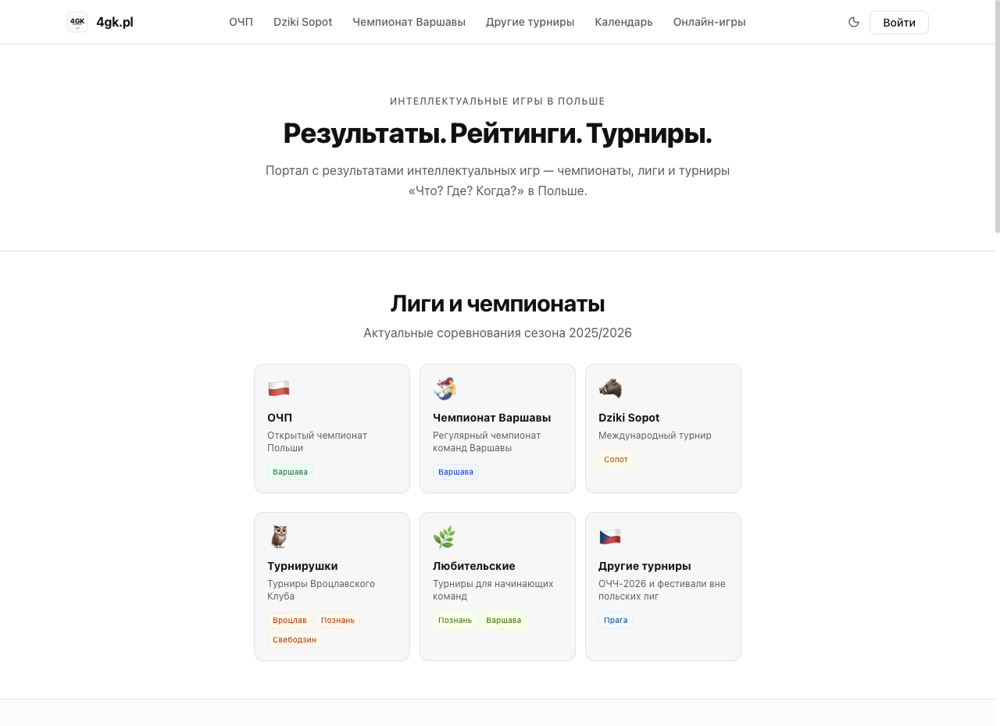
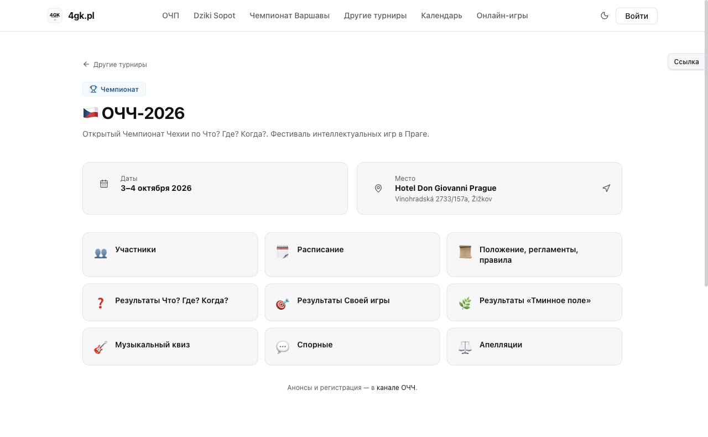
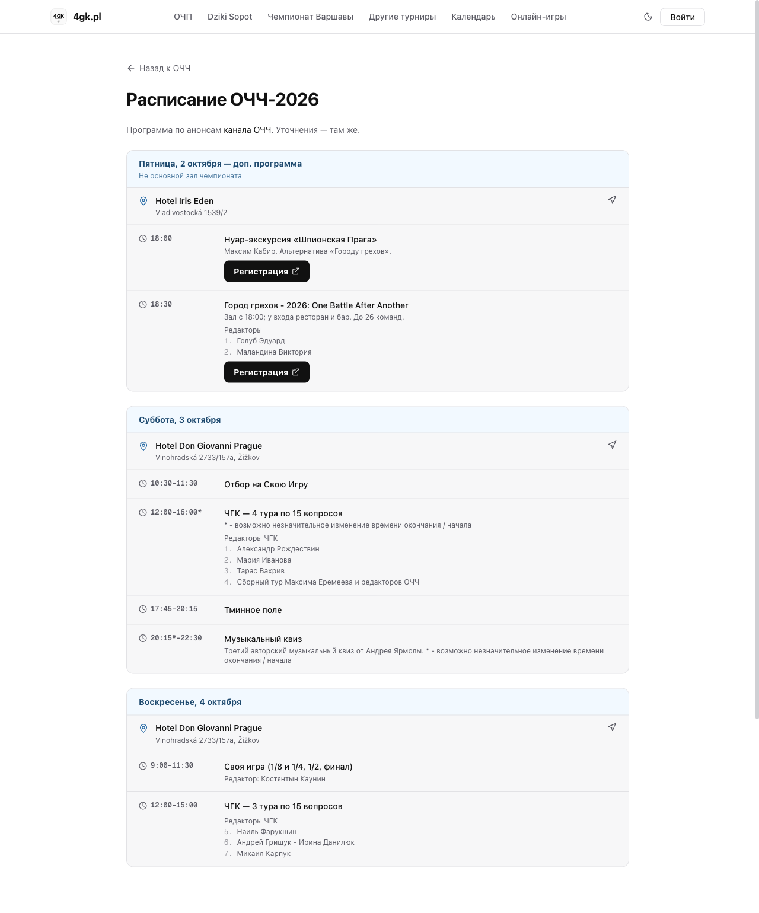
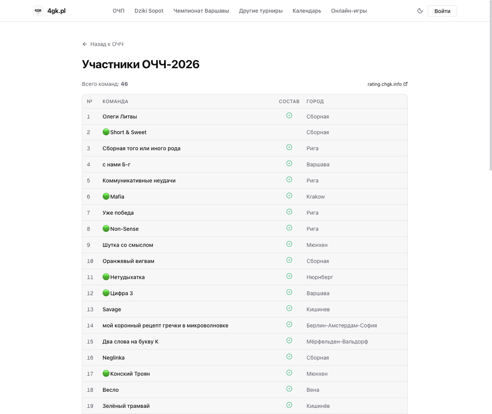
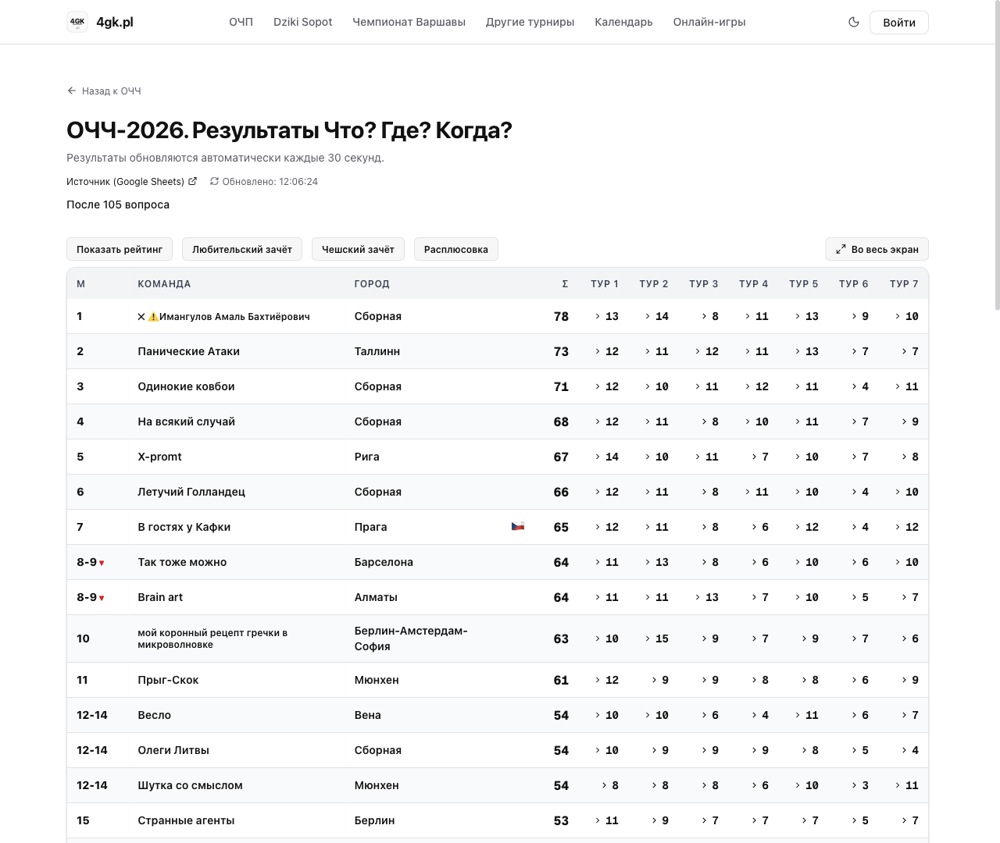
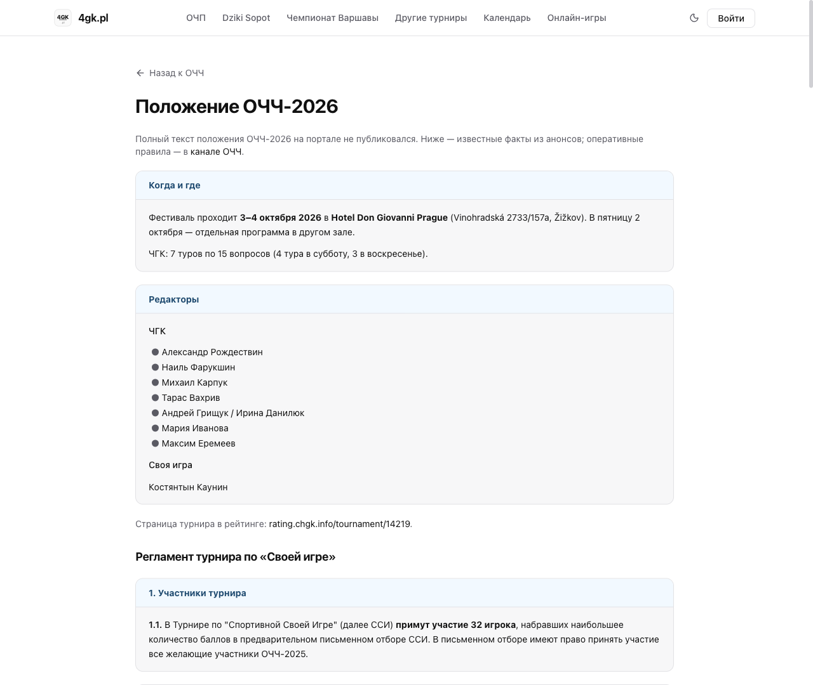
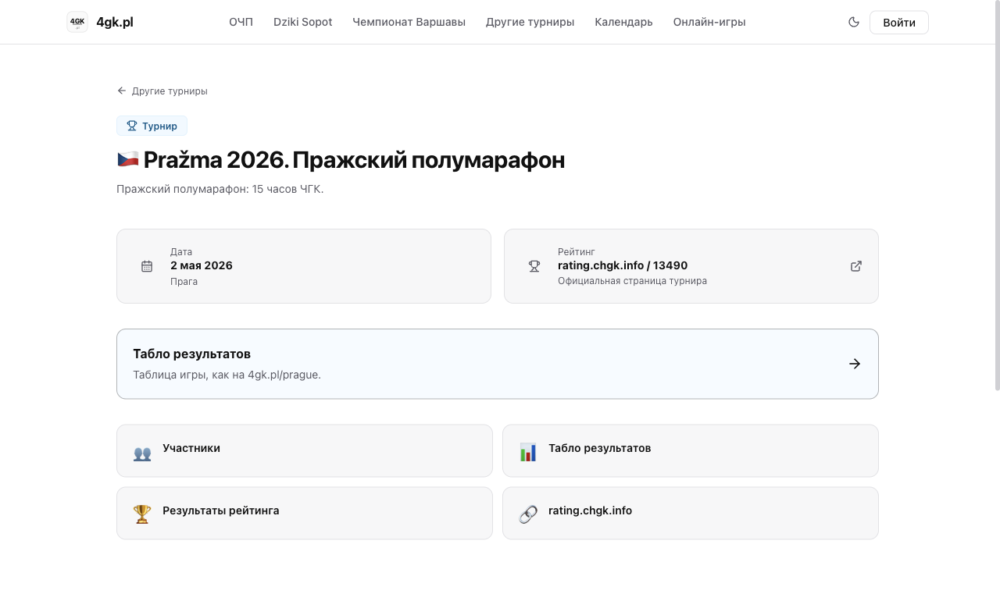

# 4gk.pl

[4gk.pl](https://4gk.pl) is a Next.js site for intellectual-games tournaments. It publishes schedules, team lists, and live results for the Polish leagues and for festivals in Prague, above all the Open Czech Championship (ОЧЧ-2026, [/ochch](https://4gk.pl/ochch)) and the Prague half-marathon Pražma ([/prazma](https://4gk.pl/prazma)).

[4gk.pl](https://4gk.pl) — сайт турниров по интеллектуальным играм на Next.js. Здесь расписание, списки команд и живые результаты польских лиг и пражских фестивалей: в первую очередь Открытого чемпионата Чехии (ОЧЧ-2026, [/ochch](https://4gk.pl/ochch)) и пражского полумарафона Pražma ([/prazma](https://4gk.pl/prazma)).

## Home

The front page is the season index: Open Polish Championship (ОЧП), the Warsaw championship, Dziki Sopot, Turnirushki (the Wrocław club), amateur events, and “other tournaments” (Prague). Further down is a calendar of games. The header also links to the full [calendar](https://4gk.pl/calendar) and to [online tools](https://4gk.pl/online-games) (a Jeopardy buzzer, Music SI, and a POC calculator).

Главная — указатель сезона: ОЧП, чемпионат Варшавы, Dziki Sopot, Турнирушки (Вроцлавский клуб), любительские турниры и «другие турниры» (Прага). Ниже — календарь игр. В шапке есть полный [календарь](https://4gk.pl/calendar) и [онлайн-инструменты](https://4gk.pl/online-games) (кнопка для «Своей игры», Music SI и калькулятор POC).

## ОЧЧ-2026

[/ochch](https://4gk.pl/ochch) is the Open Czech Championship in What? Where? When? (Что? Где? Когда?), 3–4 October 2026, Hotel Don Giovanni Prague. Friday 2 October is a side programme at another hall.

[/ochch](https://4gk.pl/ochch) — Открытый чемпионат Чехии по «Что? Где? Когда?», 3–4 октября 2026, Hotel Don Giovanni Prague. В пятницу 2 октября — отдельная программа в другом зале.

Public pages from the hub:

- [Schedule](https://4gk.pl/ochch/schedule) — Friday through Sunday, with venues and editors.
- [Participants](https://4gk.pl/ochch/participants) — teams, cities, a check when a lineup has been submitted, a flag for Czech teams, and a green mark for amateur teams. The page links to the tournament on rating.chgk.info.
- [Rules](https://4gk.pl/ochch/rules) — dates, editors, format, and the Jeopardy (Своя игра) regulations published on the site. Operational rules are in the OCHCH channel; the page says so.
- Lineup submission at [/ochch/roster](https://4gk.pl/ochch/roster). A player signs in with Google, links a rating.chgk.info id on [/account](https://4gk.pl/account), and files the team’s players. The live hub does not show a tile for this page.

Страницы с хаба:

- [Расписание](https://4gk.pl/ochch/schedule) — с пятницы по воскресенье, площадки и редакторы.
- [Участники](https://4gk.pl/ochch/participants) — команды, города, отметка о поданном составе, флаг у чешских команд и зелёная метка у любительских. Ссылка на турнир на rating.chgk.info.
- [Положение](https://4gk.pl/ochch/rules) — даты, редакторы, формат и опубликованный на сайте регламент «Своей игры». Оперативные правила — в канале ОЧЧ; страница на это указывает.
- Подача состава: [/ochch/roster](https://4gk.pl/ochch/roster). Игрок входит через Google, привязывает id с rating.chgk.info на [/account](https://4gk.pl/account) и указывает игроков команды. На живом хабе отдельной плитки для этой страницы нет.

## Live CHGK results

[/ochch/results-chgk](https://4gk.pl/ochch/results-chgk) reloads from the published sheet about every 30 seconds.

- Standings with a total and a column per tour.
- **Любительский зачёт** and **Чешский зачёт** filter the table and recompute places for that subset.
- Place arrows on the latest answered question: ▲ if the team moved up, ▼ if it moved down.
- **Расплюсовка** opens a per-tour matrix of which teams took which question.
- A rating column can be shown or hidden. Under the totals the board also prints median, mean, and trueDL. There is a fullscreen view.

[/ochch/results-chgk](https://4gk.pl/ochch/results-chgk) подтягивает таблицу из опубликованного листа примерно каждые 30 секунд.

- Общий зачёт: сумма и столбец на каждый тур.
- **Любительский зачёт** и **Чешский зачёт** оставляют в таблице только эти команды и заново считают места.
- Стрелки места по последнему введённому вопросу: ▲ — место улучшилось, ▼ — ухудшилось.
- **Расплюсовка** — матрица тура: кто взял какой вопрос.
- Колонку рейтинга можно показать или скрыть. Под суммами есть медиана, среднее и trueDL. Табло открывается на весь экран.

## SI, «Тминное поле», and the music quiz

These hub pages load on the live site:

- [Своя игра](https://4gk.pl/ochch/results-si) — qualifying table and playoff rooms.
- [«Тминное поле»](https://4gk.pl/ochch/results-tminnoe) — the score table, refreshed on a timer.
- [Music quiz](https://4gk.pl/ochch/results-quiz) — the quiz note and its result table.

Эти страницы с хаба на живом сайте открываются:

- [Своя игра](https://4gk.pl/ochch/results-si) — отборочная таблица и комнаты плей-офф.
- [«Тминное поле»](https://4gk.pl/ochch/results-tminnoe) — таблица очков с автообновлением.
- [Музыкальный квиз](https://4gk.pl/ochch/results-quiz) — описание квиза и таблица результатов.

## Controversial answers and appeals

[/ochch/controversial](https://4gk.pl/ochch/controversial) and [/ochch/appeals](https://4gk.pl/ochch/appeals) are for signed-in players. The page first asks for a linked rating id and a submitted lineup.

A player files their own controversial answer and afterwards sees only their own entries, with the jury’s verdict mark. Jury members see the full list and record the decision.

An appeal asks to credit an answer or to strike one, with a written argument. The player sees their own appeals and any explanation the jury has added. The jury sees every appeal.

[/ochch/controversial](https://4gk.pl/ochch/controversial) и [/ochch/appeals](https://4gk.pl/ochch/appeals) — для вошедших игроков. Сначала страница просит привязанный id рейтинга и поданный состав.

Игрок подаёт свой спорный ответ и потом видит только свои записи с отметкой вердикта жюри. Жюри видит полный список и фиксирует решение.

Апелляция — просьба зачесть ответ или снять его, с письменной аргументацией. Игрок видит свои апелляции и обоснование жюри, если оно уже есть. Жюри видит все апелляции.

## Calendar and account

[/calendar](https://4gk.pl/calendar) is the public list of games, with city filters. The same calendar is embedded on the home page.

[/account](https://4gk.pl/account) is Google sign-in: profile, a linked rating.chgk.info player id, and the lineups that player has submitted.

[/calendar](https://4gk.pl/calendar) — публичный список игр с фильтром по городам. Тот же календарь встроен в главную.

[/account](https://4gk.pl/account) — вход через Google: профиль, привязанный id игрока с rating.chgk.info и поданные этим игроком составы.

## Pražma

[/prazma](https://4gk.pl/prazma) is Pražma 2026, the Prague half-marathon (15 hours of CHGK), 2 May 2026. The hub links to participants, the live board at [/prague](https://4gk.pl/prague), rating results, and the tournament on rating.chgk.info (id 13490).

[/prazma](https://4gk.pl/prazma) — Pražma 2026, пражский полумарафон (15 часов ЧГК), 2 мая 2026. С хаба — участники, живое табло на [/prague](https://4gk.pl/prague), результаты рейтинга и страница турнира на rating.chgk.info (id 13490).

## Screenshots

Taken from the public site in October 2026. The CHGK board and the participants list are the top of longer tables. SI, «Тминное поле», and the music quiz are live and are not shown here. Signed-in pages (account, lineups, controversial answers, appeals) are omitted.

Снято с публичного сайта в октябре 2026. Табло ЧГК и список участников — верх длинных таблиц. «Своя игра», «Тминное поле» и музыкальный квиз на сайте есть, здесь их нет. Страницы после входа (аккаунт, составы, спорные, апелляции) не показаны.

### Home / Главная



Season index: Polish leagues and the Prague festivals.

Указатель сезона: польские лиги и пражские фестивали.

### OCHCH hub / Хаб ОЧЧ



Dates, venue, and the public sections of ОЧЧ-2026.

Даты, площадка и публичные разделы ОЧЧ-2026.

### Schedule / Расписание



Friday side programme, then Saturday and Sunday at Hotel Don Giovanni.

Пятничная доп. программа, затем суббота и воскресенье в Hotel Don Giovanni.

### Participants / Участники



Start of the team list (46 teams): city, submitted lineup, amateur mark.

Начало списка команд (всего 46): город, поданный состав, любительская метка.

### CHGK results / Результаты ЧГК



Live standings with amateur and Czech filters, расплюсовка, and place arrows.

Живой зачёт с любительским и чешским фильтрами, расплюсовкой и стрелками мест.

### Rules / Положение



Top of the rules page: dates, editors, and the start of the SI regulations.

Верх страницы положения: даты, редакторы и начало регламента «Своей игры».

### Pražma



Prague half-marathon hub, including the link to the live board.

Хаб пражского полумарафона, включая ссылку на живое табло.

## Development

Next.js 16, React 19, TypeScript, Tailwind CSS 4, Prisma 6, PostgreSQL, NextAuth. The production image uses Node 22. Local setup:

```bash
cp .env.example .env
npm install
docker compose up -d db
npx prisma generate --schema=src/prisma/schema.prisma
npx prisma db push --schema=src/prisma/schema.prisma
npm run dev
```

Open [http://localhost:3000](http://localhost:3000).

`.env.example` names what the app reads: `DATABASE_URL` for the Compose Postgres on host port 5433, NextAuth, and Google OAuth. Keep real values in `.env` and do not commit that file. Public pages need the database. Google sign-in needs the OAuth client values from the example file.

There is no migration history. Schema changes go through `npx prisma db push --schema=src/prisma/schema.prisma`.

Production updates use [`./deploy.sh`](./deploy.sh). The script header is the deploy note. That script does not run `db push`.

Next.js 16, React 19, TypeScript, Tailwind CSS 4, Prisma 6, PostgreSQL, NextAuth. Образ в Dockerfile — Node 22. Локальный запуск — команды выше.

[`.env.example`](./.env.example) перечисляет переменные: `DATABASE_URL` на Postgres из Compose (порт хоста 5433), NextAuth и Google OAuth. Настоящие значения лежат в `.env`, этот файл в git не кладут. Публичным страницам нужна база. Входу через Google — клиент OAuth из примера.

Истории миграций нет. Схему применяют так: `npx prisma db push --schema=src/prisma/schema.prisma`.

Боевое обновление — [`./deploy.sh`](./deploy.sh). Что делает скрипт, написано в его шапке. `db push` он не запускает.
